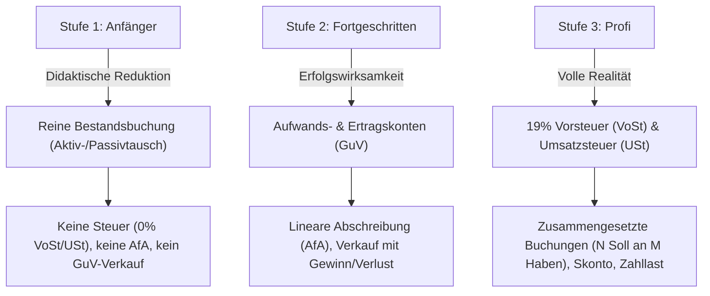
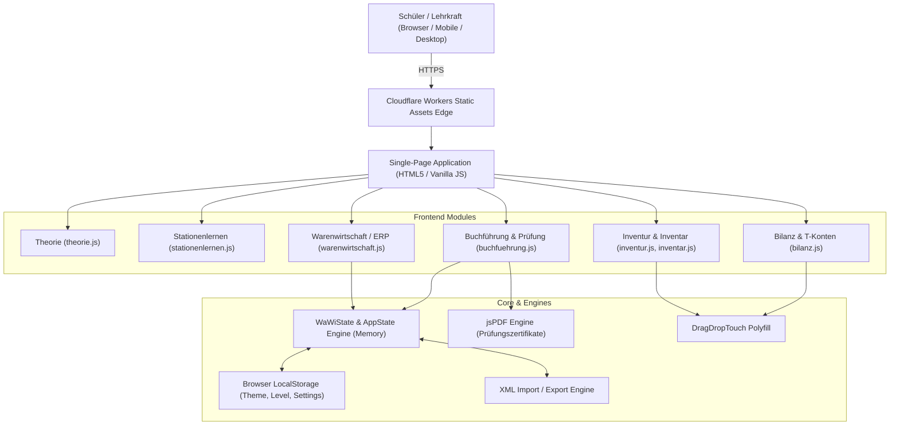

# 📖 Buchhaltungstrainer: Technische Gesamtdokumentation

> **Hinweis für KI-Assistenten & Entwickler**:
> Dieses Dokument ist die **Single Source of Truth** für alle technischen, didaktischen und architektonischen Details des Projekts *Buchhaltungstrainer* (Modellunternehmen: *Fire Bike GmbH*).
> Jede KI, die an diesem Projekt arbeitet, **muss** diese Spezifikation beachten und bei Code-, Schema-, Feature- oder Versions-Änderungen dieses Dokument im Obsidian Vault **automatisch aktualisieren**.

---

## 1. Projektübersicht & Fachlicher Kontext

### 1.1 Zweck & Zielsetzung
Der **Buchhaltungstrainer** ist eine interaktive, webbasierte Lern- und Simulationsplattform für Schüler, Auszubildende und Studierende der kaufmännischen Bildung (z. B. an Berufskollegs und Wirtschaftsschulen). 
Die Plattform ermöglicht es, das gesamte Spektrum der kaufmännischen Buchführung praxisnah und interaktiv zu erlernen – von der physischen Bestandserfassung im Lager über die Bilanzierung bis hin zur vollständigen ERP-Warenwirtschaftssimulation inklusive Anlagenmanagement, Abschreibungen (AfA) und zusammengesetzten Buchungssätzen.

### 1.2 Modellunternehmen: Fire Bike GmbH
Als didaktischer Bezugsrahmen fungiert die **Fire Bike GmbH**, ein mittelständischer Hersteller von hochwertigen Fahrrädern und E-Bikes. 
* **Fertigungspalette**: City-Bikes, Mountainbikes, E-Bikes.
* **Fertigungsstruktur**: Mehrstufige Produktion aus Rohstoffen (Rahmen, Schaltungen, Reifen, Bremsen), Hilfsstoffen (Schrauben, Lacke, Schmiermittel) und Betriebsstoffen (Strom, Fertigungsöle).
* **Anlagenstruktur**: Eigenes Betriebs- und Verwaltungsgebäude (0510), Technische Anlagen & Maschinen (0700), Fuhrpark (0840), Betriebs- und Geschäftsausstattung (0860).

### 1.3 Didaktisches Stufenkonzept (Niveaustufen)
Um Lernende schrittweise von den Grundlagen zur vollen kaufmännischen Realität zu führen, sind die Kernmodule (Buchführung und Warenwirtschaft) in drei didaktisch abgestimmte Niveaustufen unterteilt:



#### Detailbeschreibung der Niveaustufen:
1. **Anfänger**:
   * Konzentration auf Bestandsbuchungen (Aktivtausch, Passivtausch, Bilanzverkürzung/-verlängerung).
   * Verkäufe auf Ziel werden didaktisch reduziert als Aktivtausch zum Herstellungspreis gebucht (Forderungen an Fertigerzeugnisse).
   * Produktion, Vertrieb und AfA sind in der Warenwirtschaft bewusst gesperrt, um Überforderung zu vermeiden.
2. **Fortgeschritten**:
   * Einführung der Erfolgskonten (Umsatzerlöse 5000, Aufwendungen für Rohstoffe 6000, etc.).
   * Lineare Abschreibung (AfA, Konto 6520) pro-rata temporis auf das Anlagevermögen.
   * Verkäufe erfolgen mit Gewinnspanne über Erfolgskonten.
3. **Profi**:
   * Volle steuerliche Erfassung: 19 % Vorsteuer (2600) und 19 % Umsatzsteuer (4800).
   * Zusammengesetzte Buchungssätze mit mehreren Soll- und Haben-Konten (z. B. Rohstoffeinkauf teils bar, teils Bank, zzgl. Vorsteuer).
   * Erfassung von Steuervorauszahlungen, Zahllast und Skontobuchungen.

---

## 2. Technische Architektur & Tech Stack



### 2.1 Tech-Stack & Komponenten
* **Frontend**: Vanilla JavaScript (ES6+), semantic HTML5, CSS3 mit Custom Properties (CSS Variables), CSS Grid und Flexbox. Keine schweren Frameworks (Zero-Dependencies zur Laufzeit).
* **Polyfills**: `drag-drop-touch.js` zur lückenlosen Unterstützung von Drag & Drop auf mobilen Touch-Displays (iPad, iPhone, Android-Tablets).
* **Export- & Dokumentengenerierung**: `jspdf` zur serverseitig unabhängigen, clientseitigen Erstellung manipulationssicherer Prüfungszertifikate im PDF-Format.
* **Hosting & CDN**: Cloudflare Workers mit Static Assets (`[assets] directory = "./"`).

---

## 3. Design System & Theming-Architektur

Die Plattform verfügt über ein flexibles, in `style.css` verankertes Theme-System mit drei gleichwertigen Farb- und Bedienwelten:

| Theme | Selector | Beschreibung & Design-Sprache |
| :--- | :--- | :--- |
| **Dunkel (Dark)** | `body:not(.light-mode):not(.pro-mode)` | Ursprüngliches Design: Dunkler Canvas (`#0b1329`), sanfte Glasmorphismus-Effekte, Akzentfarben Cyan/Blau. |
| **Hell (Light)** | `body.light-mode` | Freundliche, kontraststarke helle Arbeitsumgebung für sonnige Unterrichtsräume. |
| **Pro (Enterprise)** | `body.pro-mode, body.sap-mode` | **Neu in v0.2.5**: Orientiert am modernen SAP ERP (S/4HANA Cloud / Fiori Horizon). Canvas `#f5f6f8`, Shell-Bar `#1d2d3e`, Primärblau `#0070f2`, neutrale Slates, Inter-Typografie. |

### 3.1 Pro Theme Spezifikation (v0.2.5)
* **Shell-Header**: Dunkelblauer Enterprise-Header (`#1d2d3e`) mit Mandanten-Tag (`Mandant 100 • FI/CO`).
* **Kontrasthärtung für Bedienelemente**:
  * **Toggles (`.wawi-slider`)**: Im Aus-Zustand besitzt der Schieberegler eine deutlich sichtbare graue Schiene (`#cbd5e1`), einen Slate-Rahmen (`#89919a`) und einen weißen Schiebeknopf mit Schlagschatten (`box-shadow: 0 1px 4px rgba(0,0,0,0.35)`). Im Ein-Zustand wechselt die Schiene in SAP-Blau (`#0070f2`).
  * **Inaktive Buttons (`.btn-primary:not(.active)`)**: Weißer Kartenhintergrund mit `#cbd5e1`-Rand und `#334155`-Text (beseitigt unleserliches `rgba(255,255,255,0.05)`).
  * **Dropzones & Matching-Pools**: `#f8fafc`-Fläche mit `#94a3b8`-gestricheltem 2px-Rahmen.
  * **Formulareingaben (`.buchung-form`)**: Saubere Container mit `#e2e8f0`-Rand und Innenabschattung.
* **Persistenz**: Die Theme-Wahl wird persistent in `localStorage.getItem('bw_theme')` abgelegt (`'dark'`, `'light'` oder `'pro'`).

---

## 4. Fachmodule im Detail

### 4.1 Theorie (`theorie.js`)
* Interaktive Theorie-Karten zu den Grundlagen des Rechnungswesens:
  * Aufgaben der Buchführung, gesetzliche Grundlagen (HGB).
  * Inventur, Inventar und Aufbau der Bilanz (Aktiva vs. Passiva).
  * Unterscheidung von Bestands- und Erfolgskonten.
  * Grundsatz „Soll an Haben“ und Bildung einfacher/zusammengesetzter Buchungssätze.

### 4.2 Stationenlernen (`stationenlernen.js`)
* Strukturierter Lernpfad mit thematischen Stationen und steigendem Schwierigkeitsgrad (Anforderungsbereiche I bis III).
* Sofortiges didaktisches Feedback bei falschen Eingaben inklusive detaillierter Lösungswege.

### 4.3 Inventur & Inventar (`inventur.js`, `inventar.js`)
* **Lagerhalle (Inventur)**: Physische Zählung und Bestandsaufnahme von Fahrrädern, E-Bikes und Werkstoffen in einem virtuellen Hochregallager.
* **Inventar**: Überführung der gezählten Mengen und Werte in das gesetzliche Staffelverzeichnis nach § 240 HGB (Vermögen, Schulden, Reinvermögen/Eigenkapital).

### 4.4 Bilanz (`bilanz.js`)
* Interaktive T-Bilanz mit zwei Flügeln (Aktiva / Passiva).
* Drag-&-Drop-Zuordnung von Bilanzposten nach dem Liquiditäts- und Fälligkeitsprinzip.
* Automatische Prüfung der Bilanzgleichheit (Summe Aktiva === Summe Passiva).

### 4.5 Finanzbuchhaltung (FiBu) & Prüfungsmodus (`buchfuehrung.js`)
* **Geschäftsfall-Generator**: Über 235 verschiedene Praxisfälle, aufgeteilt auf die drei Niveaustufen.
* **Compound Bookings**: Dynamisches Formular für beliebig viele Soll- und Haben-Zeilen.
* **Prüfungsmodus (Exam Mode)**:
  * 5-Minuten Countdown-Timer.
  * 10 zufällig ausgewählte Buchungsfälle der gewählten Niveaustufe.
  * Fixierte Schülernamenseingabe vor Start (Schutz vor nachträglicher Manipulation).
  * Automatisches Generieren eines signierten PDF-Leistungszertifikats mit Prozentrang, Note und Detail-Fehleranalyse.

### 4.6 Warenwirtschaft / ERP-Simulation (`warenwirtschaft.js`)
Vollständiger Lebenszyklus eines Industrieunternehmens:
1. **Dashboard & KPIs**: Liquidität, Lagerwert, Periodengewinn, Auslastung.
2. **Beschaffung**: Lieferantenbestellungen mit Mengenstaffeln, Zahlungsziel- und Skontobedingungen.
3. **Lager & Disposition**: Höchstbestandsüberwachung, Mindestbestände, automatische Bestellblockaden bei Überfüllung.
4. **Fertigung (BOM)**: Mehrstufige Stücklisten für City-Bikes und E-Bikes. Automatische Entnahme von Roh-, Hilfs- und Betriebsstoffen.
5. **Vertrieb**: Angebotserstellung, Kundenaufträge, Rechnungsstellung und Forderungsüberwachung.
6. **Anlagenmanagement**: Anschaffung von Anlagegütern mit Split-Payment (Bank, Darlehen, Kasse, Verbindlichkeiten), lineare AfA und Anlagenverkauf.
7. **Finanzwesen (FI)**: Echzeit-Synchronisierung von Journal, Hauptbuch (T-Konten), GuV und Schlussbilanz.

---

## 5. Deployment & Cloudflare Workers

Die Anwendung wird über **Cloudflare Workers mit Static Assets** gehostet.

### 5.1 Konfiguration (`wrangler.toml`)
```toml
name = "buchhaltungs-trainer"
compatibility_date = "2024-05-25"

[assets]
directory = "./"
```

### 5.2 Produktions-URL & Domains
* **Live-URL**: `https://buchhaltungs-trainer.workers.dev`
* **Deployment-Befehl**:
  ```bash
  npx wrangler deploy
  ```
  *(Nur geänderte Assets werden dank Content-Hashing übertragen; der Upload dauert typischerweise wenige Sekunden).*

---

## 6. Lokales Setup & Entwicklung

### 6.1 Server starten
Da moderne Browser module- und asset-basierte Beschränkungen (CORS / Local Filesystem) aufweisen, wird die Anwendung über einen lokalen HTTP-Server getestet:
```bash
# Projektverzeichnis
cd Buchhaltungstrainer

# Lokaler HTTP-Server (Port 8085)
python3 -m http.server 8085
```
Alternativ kann das im Repository enthaltene Skript `start-server.command` per Doppelklick ausgeführt werden.

---

## 7. Versionshistorie & Changelog

### v0.2.6 (23.10.2026)
* **Creative Commons Lizenzierung (CC BY-NC 4.0)**:
  * Vollständige Umstellung auf die CC BY-NC 4.0-Lizenz (Namensnennung - Nicht-kommerziell).
  * Einbindung des offiziellen CC-Badges und klar verständlicher Lizenzbedingungen im Impressum der Webanwendung sowie im Sidebar-Footer.
* **Public GitHub Release & Datenschutz-Härtung**:
  * Bereinigung und Veröffentlichung als öffentliches Open-Source-Repository auf GitHub (`mrgoldsmitt/Buchhaltungstrainer`).
  * Vollständige Anonymisierung lokaler Entwicklerpfade, interner Ordner und privater E-Mail-Adressen.
  * Bereitstellung von `deploy_release.sh` zur automatisierten Paketierung von Offline-ZIP-Distributionsarchiven und GitHub Releases.
  * Bereitstellung eines umfassenden `README.md` mit Facharchitektur, Modulübersicht und Schnellstartanleitung.

### v0.2.5 (17.10.2026)
* **Neues Theme: Pro (Enterprise Edition)**:
  * Hochwertiges, am neuesten SAP ERP (Fiori Horizon) angelehntes Design (`body.pro-mode`, `body.sap-mode`).
  * Fiori Shell-Bar mit dezenter Mandanten-Kennzeichnung (`Mandant 100 • FI/CO`).
  * 3-Wege-Umschalter (Dunkel, Hell, Pro) im Header und in der Navigationsleiste.
* **Kontrasthärtung & Barrierefreiheit für Pro- und Light-Themes**:
  * Toggles (`.wawi-slider`): Im Aus-Zustand nun mit sichtbarem `#89919a`-Rahmen, `#cbd5e1`-Schiene und weißem Schatten-Knopf; im Ein-Zustand in Fiori-Blau (`#0070f2`).
  * Inaktive Buttons (`.btn-primary:not(.active)`) auf hellem Grund lesbar gestaltet (Weiß mit Kontur statt transparent).
  * Bilanz-Dropzones und Matching-Pools mit 2px gestricheltem Rahmen auf `#f8fafc`.
  * Buchungs-Container (`.buchung-form`) mit Innenabschattung und definierten Rändern.
* **Versions-Harmonisierung**:
  * Vereinheitlichung der Version auf **v0.2.5** im Changelog, Sidebar-Footer, Header und in der Obsidian-Dokumentation.
* **Cloudflare Workers Asset Deployment**:
  * Live-Bereitstellung auf `https://buchhaltungs-trainer.workers.dev`.

### v0.2.0 (16.08.2026)
* **Mobile- & Tablet-Optimierung**:
  * Responsives Redesign der Warenwirtschaft für Displays unter 7 Zoll (u. a. iPhone 13 Mini).
  * Optimierte Darstellung der T-Konten-Spalten ohne horizontales Abschneiden.
  * Behebung von Überschneidungen in der Header-Zeile.

### v0.1.6.4 (16.07.2026)
* **Didaktische Präzisierung im Anfängermodus**:
  * Sperrung von Produktion, Vertrieb und AfA im Anfängermodus mit klaren Hinweisen auf den Fortgeschrittenen-Modus.

### v0.1.6.0 (20.05.2026)
* **Anlagenmanagement & Lebenszyklus**:
  * Einführung der Abteilung Anlagenmanagement (Gebäude 0510, Maschinen 0700, Fuhrpark 0840, BGA 0860).
  * Lineare AfA und Split-Payments beim Kauf/Verkauf von Anlagen.

### v0.1.5.0 (16.05.2026)
* **Zusammengesetzte Buchungssätze & Prüfungsmodus**:
  * Unterstützung für N Soll an M Haben Buchungen.
  * Einführung des Prüfungsmodus mit Timer und manipulationssicherem PDF-Zertifikat.
